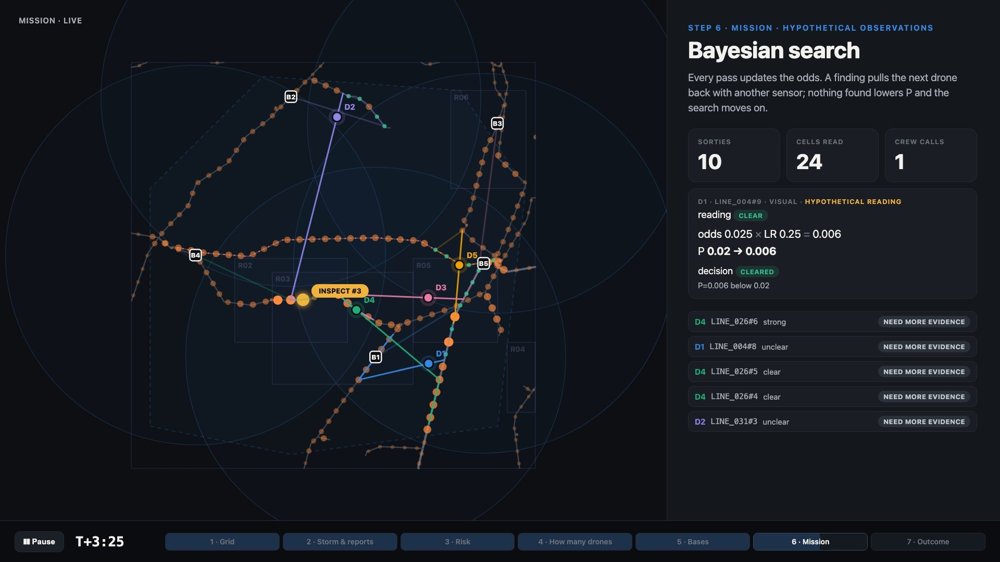
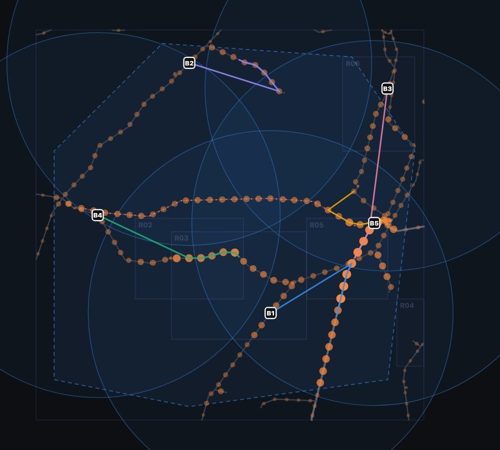
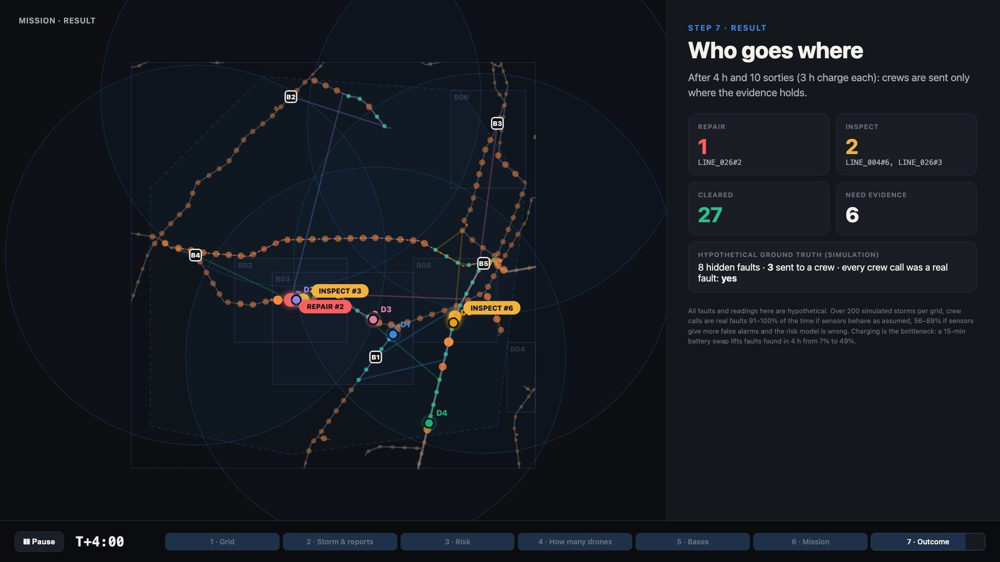

# PowerDrone: Storm Drone Response

**Nomadic Challenge · Keeping the Power Flowing** · Team PowerDrone

> A storm has passed through a region. Some areas have lost power, six reports have come in, and the operator has to decide where to look first.
> PowerDrone runs **five line-sitting sensor packages** across a real 198 km section of the Bavarian grid.
> It turns every report and every sensor reading into a clear recommendation: **keep searching, send an inspection crew, or send a repair crew.**

| | |
|---|---|
| 🎞 **Demo video** (40 s, one full mission) | [docs/media/storm_drone_response.mp4](docs/media/storm_drone_response.mp4) |
| 📋 **Answers to the brief, point by point** | [SUBMISSION.md](SUBMISSION.md) |
| 🔧 **Full technical reference** | [docs/SYSTEM.md](docs/SYSTEM.md) |



> Everything below uses the real grid from the challenge package and its fictional storm and reports. **All sensor readings and faults are hypothetical (simulated)**: the package contains no live readings and no confirmed fault locations.

---

## 1. The idea in one minute

1. **Read the reports.** Each of the six reports is classified by an AI model (JEV). It tells us what kind of problem the report describes and how likely it is to be about the power grid at all. A tree on a line counts for a lot; an "orange flash, maybe a generator test" counts for little.
2. **Score every kilometre.** Each 1 km of line gets a **probability that something is wrong there** (storm area, wind across the line, nearby vegetation, the reports) and a **consequence** (high-voltage lines and lines with no backup path matter more).
3. **Place the five packages.** They start on **live** lines, because a package can only recharge on a live line. Together they reach every kilometre, and they sit as close as possible to the riskiest stretches.
4. **Search, learn, repeat.** Each 30-minute flight inspects up to ~8 km.
   - **Something found:** that stretch's probability jumps, and the next package returns with a different sensor to confirm.
   - **Unclear reading:** the stretch is revisited.
   - **Nothing found:** the probability drops and the search moves on.

   After landing, a package charges for 3 hours **where it landed**, so the fleet naturally moves toward the evidence.
5. **Decide.** A **repair crew** goes only where two independent sensors agree (probability ≥ 80%). An **inspection crew** goes when waiting for the next flight would cost more than the visit. Everything else stays "need more evidence".

**Why it helps the operator:** fewer blind trips, crews go where the evidence is, and every recommendation shows the reasoning behind it (odds before × strength of evidence = odds after).

---

## 2. What we measure

For a **windstorm** we focus on three problems: **vegetation on or near lines**, **conductors swinging or sagging too low**, and **damaged connections running hot**.

| Sensor | What it tells us | What it **cannot** tell us |
|---|---|---|
| Camera | branches on a line, broken strands, fallen trees | anything at night or in fog; damage inside equipment |
| Thermal camera | a hot joint, compared with the next span | anything on a dead line (no current, so no heat) |
| 3D / LiDAR | sag, clearance to trees and ground, sway | gusts that happened while it was not there |
| Wind + motion (IMU) | local gusts; context for motion readings | a fault on its own |
| Voltage | whether the line is live, so the package may charge there | *why* a line is dead |

Each pass over 1 km gives one combined reading, used as **evidence strength** (how much more likely the reading is if there is a fault):

| Reading | Evidence strength |
|---|---|
| strong | × 8 |
| weak | × 2 |
| unclear | × 1 (nothing learned) |
| nothing found | × 0.25 (sensors can miss) |

---

## 3. Where the packages start (dataset IDs)



| Package | Sits on line | Nearest node | First targets |
|---|---|---|---|
| P1 | LINE_015 | SUBSTATION_15 *Umspannwerk Schwabmünchen* | LINE_026, LINE_004 |
| P2 | LINE_062 | SUBSTATION_11 | LINE_031, LINE_035 |
| P3 | LINE_039 | SUBSTATION_12 *Umspannwerk Leitershofen* | LINE_054, LINE_003 |
| P4 | LINE_064 | SUBSTATION_01 *UW Balzhausen* | LINE_024 (dead: inspect only), LINE_064 |
| P5 | LINE_004 (380 kV) | NODE_026, beside SUBSTATION_07 *Oberottmarshausen* | LINE_004, LINE_002 |

- **LINE_024** is never a start point: report 3 says it was switched off, so a package there could not recharge.
- **Coverage:** 100% of the 198 km is within reach.
- **Starting charge:** all packages are full at T+0.

---

## 4. One example mission (hypothetical observations)

| Time | What happens | Result |
|---|---|---|
| T+0:00 | Five packages fly. P1 sees a **strong** visual sign on LINE_004#6 (P 4% → 23%). P4 finds **strong** thermal and 3D signs on LINE_026. Two readings are **unclear** (gusts). P5 starts over the dead LINE_024 and must land on the nearest live line | LINE_026#3 → **inspection** (P 51%) |
| T+0:24 → 3:22 | Everyone charges 3 h where they landed | the crew drives to LINE_026#3 |
| T+3:22 | P5 returns to LINE_004#6 with a **different sensor (3D scan): strong** (P 23% → 71%) | **inspection** |
| T+3:23 | P2 returns to LINE_026#2: **camera strong**, after an earlier thermal strong | P 89% → **repair** (two sensors agree) |
| T+3:22 | P3 passes LINE_026#6: **nothing found** (P 45% → 17%) | an honest **miss**: the fault was there |



**After 4 hours:**
- 1 repair, 2 inspections, 27 stretches cleared, 6 waiting for more evidence;
- all 3 crew calls hit real (simulated) faults;
- 5 of 8 faults were not found: two on the dead 27 km line beyond reach, two never flown, and one missed by a clean pass.

---

## 5. How well does it work, honestly?

200 simulated storms per setting, on the challenge grid plus four very different generated grids (Lyon, Texas, Norway, Tokyo):

| | Result |
|---|---|
| Crew calls that hit a real fault, sensors as assumed | **91–100%** (Bavaria: 98%) |
| Same, with noisier sensors and a wrong risk model | **56–88%** (Bavaria: 58%) |
| Faults found in the first 4 h: 3 h charge → 15-min battery swap | **7% → 49%** (mean of 5 grids) |
| Bayesian search vs. a probability-blind patrol | better on **4 of 5** grids; loses on a tiny dense grid where an even sweep sees everything |

**Takeaways:**
- **Decisions are reliable;** coverage is limited by **charging, not by the algorithm**.
- **All numbers come from simulation.** Real sensor field trials and outage history are needed for real numbers.

---

## 6. Technical overview

```
reports ──► JEV classifier ──► evidence (likelihood ratios)
grid    ──► ML imputation ──► risk per 1 km cell ──► fleet sizing ──► base placement
                                       ▲                                  │
                                       └── Bayesian update ◄── sortie planner ◄─┘
                                                  │
                                                  ▼
                                   decision: clear / evidence / inspect / repair
```

| Component | Method | File |
|---|---|---|
| Input layer | Reads **any** power-line GeoJSON (field-name aliases, volts → kV, lengths from geometry). Finds the storm area, report areas and dead lines from the scenario files | `common/grid_io.py` |
| **ML: missing data** | Random forest predicts missing line fields (circuits: 21 of 64 missing). Cross-validated: **95%** vs. 76% baseline, AUC 0.89; fills a gap only at ≥ 70% confidence | `ml/impute.py` |
| **JEV: report classifier** | TypeSafe AI's JEV (`jev-1.14.0`, online). Two typed questions per report: hazard class (7 options) and "about the grid at all?". Evidence = P(grid) · Σ P(hazard)·LR + (1 − P(grid)). Offline fallback: a keyword rule | `ml/report_classifier.py` |
| Risk per km | Prior = base rate × storm exposure × seasonal factors (crosswind, ice, vegetation, lightning, heat sag); report evidence applied as odds × LR scaled by the report's confidence. Consequence = relative voltage × radial feed × dead line | `response/model.py` |
| **ML: learned risk** | Poisson GLM / gradient boosting on outage history (per line: events, faults), selected by leave-one-grid-out deviance. Synthetic demo: AUC 0.68 → 0.72 on unseen grids | `ml/risk_model.py` |
| Fleet sizing | For K = 1…10: place bases, simulate storms, net value = faults found × consequence × outage cost − package cost. One-standard-error rule → here 3 would suffice; 5 give margin | `response/fleet.py` |
| Base placement | Maximal covering location over line length (greedy + swaps), then p-median pull toward risk; live lines only | `placement/` |
| Sortie planner | Picks a run of adjacent cells maximising Σ P × consequence × detection, subject to transit + inspection + landing on a live line ≤ 24 min (capacitated arc routing / E-VRP constraints) | `response/model.py` |
| Bayesian search | Odds × LR per reading; neighbours × 1.5 on a finding; cells reserved while another package flies | `response/model.py` |
| Decision rule | Expected cost of waiting (P × consequence × outage cost × crew ETA) vs. crew cost; repair needs two independent strong readings | `response/model.py` |

**Assumptions:**
- 54 km/h transit, 20 km/h inspection, 6 min reserve, 3 h charge;
- detection probability 0.75 in storm conditions;
- every line is live unless a report says otherwise; checked by the voltage sensor on landing;
- costs are relative units.

Every assumption lives in **one file**, `common/config.json`. Nothing in the code is tied to this dataset: `tests/test_generic.py` runs the full pipeline on a random grid in another country with another schema.

**Limits:**
- sensor reliability is assumed;
- no customer or critical-facility data;
- the thermal camera is blind on dead lines;
- all performance numbers are simulated.

**What we would test next:**
- sensor field trials on known defects;
- replaying past storms with outage history;
- battery swap vs. charging;
- whether operators trust the advice.

---

## 7. Run it

```sh
pip install -r requirements.txt                                        # numpy, scikit-learn, joblib
export TYPESAFE_API_KEY=...                                            # optional: JEV online; keywords otherwise

python3 -I response/fleet.py   --data participant_package               # how many packages pay off
python3 -I response/model.py   --data participant_package --season autumn   # mission log + decisions
python3 -I viz/export_trace.py --data participant_package && python3 -I viz/build.py   # rebuild the animation
python3 -I bench/benchmark.py  --package participant_package --stress   # honesty test (§5)
python3 -I tests/test_generic.py                                       # runs on a different, random grid
```

### Repository map

| Path | What it is |
|---|---|
| `SUBMISSION.md` | the brief, answered point by point |
| `docs/SYSTEM.md` | full technical reference |
| `common/` | input layer + every assumption (`config.json`) |
| `ml/` | ML imputation, learned risk model, JEV report classifier |
| `placement/` | base placement and seasonal risk maps |
| `response/` | risk model, sortie planner, Bayesian search, decisions, fleet sizing |
| `viz/` | the mission animation (`animation.html`) |
| `bench/` | multi-grid benchmark and stress test |
| `tests/` | generality test |
| `engine.js`, `template.html`, `build.py` | our first interactive prototype (`python3 -I build.py participant_package`, then open `index.html`) |

---

## Drone concept: half-propeller de-icer


AI-generated concept render (Gemini) for winter use: inline-skate wheels roll the package along the conductor while a shrouded half propeller above the cable breaks ice off ahead of it, charging from the live line as it crawls.


---

Grid data © OpenStreetMap contributors, ODbL 1.0. Storm, reports, faults and sensor readings are fictional.
