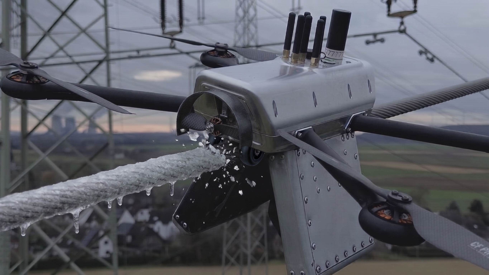
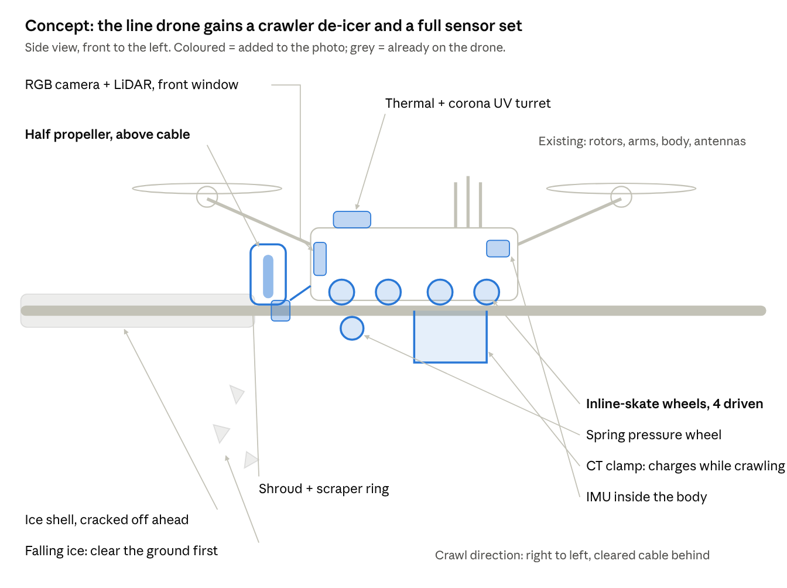

# PowerDrone

Post-storm grid triage with five line-riding sensor packages (EHL hackathon, synthetic Bavarian windstorm scenario).

- `engine.js`: Bayesian fault ranking per line and hazard, sortie planner (30 min flight, 3 h charge on live lines only).
- `template.html`: the interactive page with map, flight/charge timeline, decision log and hazard playbooks.
- `build.py`: injects the participant package data and the engine into `index.html`.

- `ml/`: machine learning: missing-field imputation, a fault-risk model learned from history, and a report classifier (JEV online / keywords offline); see `ml/README.md`.
- `viz/`: presentation animation of the whole pipeline on a real run (`viz/animation.html`).
- `bench/`: benchmark on 5 grids x 16 settings x 200 simulated events, with a visual report (`bench/out/report.html`).
- `tests/test_generic.py`: runs placement and response on a different, randomly generated grid to keep the solution generic.

```sh
python3 -I build.py /path/to/participant_package
open index.html
```
**Full system reference (algorithms, files, inputs/outputs, config): [docs/SYSTEM.md](docs/SYSTEM.md).**

- `common/`: generic input layer (`grid_io.py`) and every assumption of the system (`config.json`); nothing is tied to one dataset.
- `placement/`: placement of K bases with radius R on any grid (coverage, seasonal risk, maps); see `placement/README.md`.
- `response/`: what happens after each drone reading (Bayesian search, flight/charge limits) and when to recommend inspection or repair; see `response/README.md`.

All sensor readings in the walkthrough are hypothetical. Grid data © OpenStreetMap contributors, ODbL 1.0.

## Drone concept: half-propeller de-icer



AI-generated concept render (Gemini): inline-skate wheels roll the package along the conductor while a shrouded half propeller above the cable breaks ice off ahead of it, charging from the live line as it crawls.


