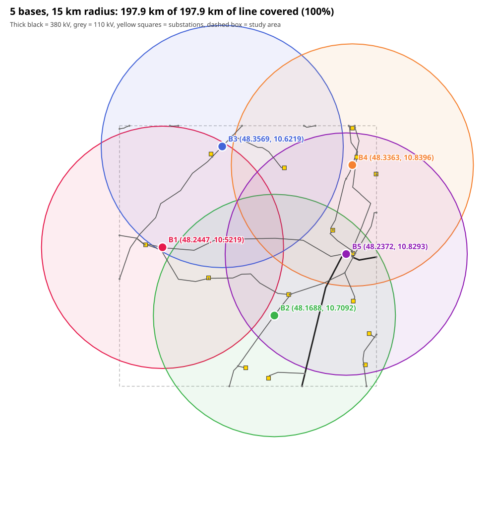
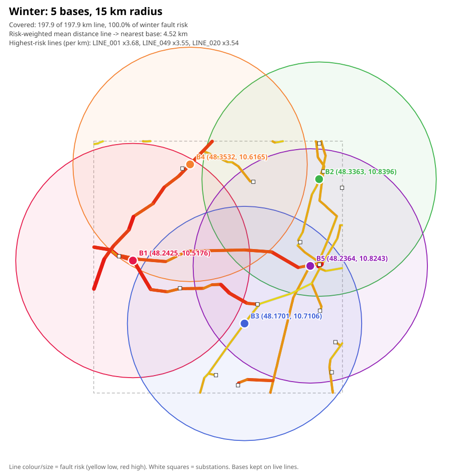
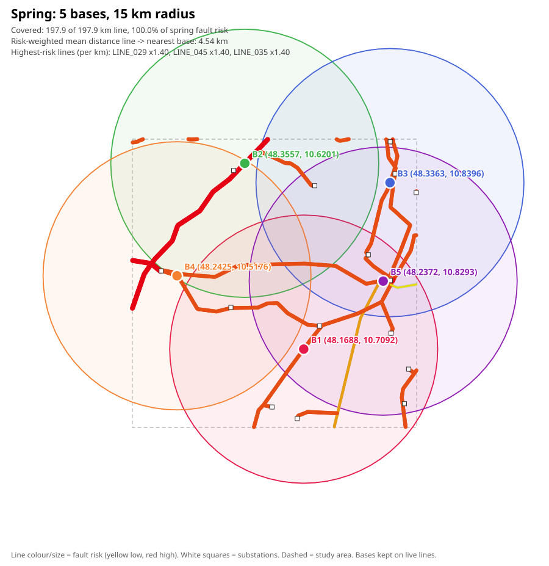
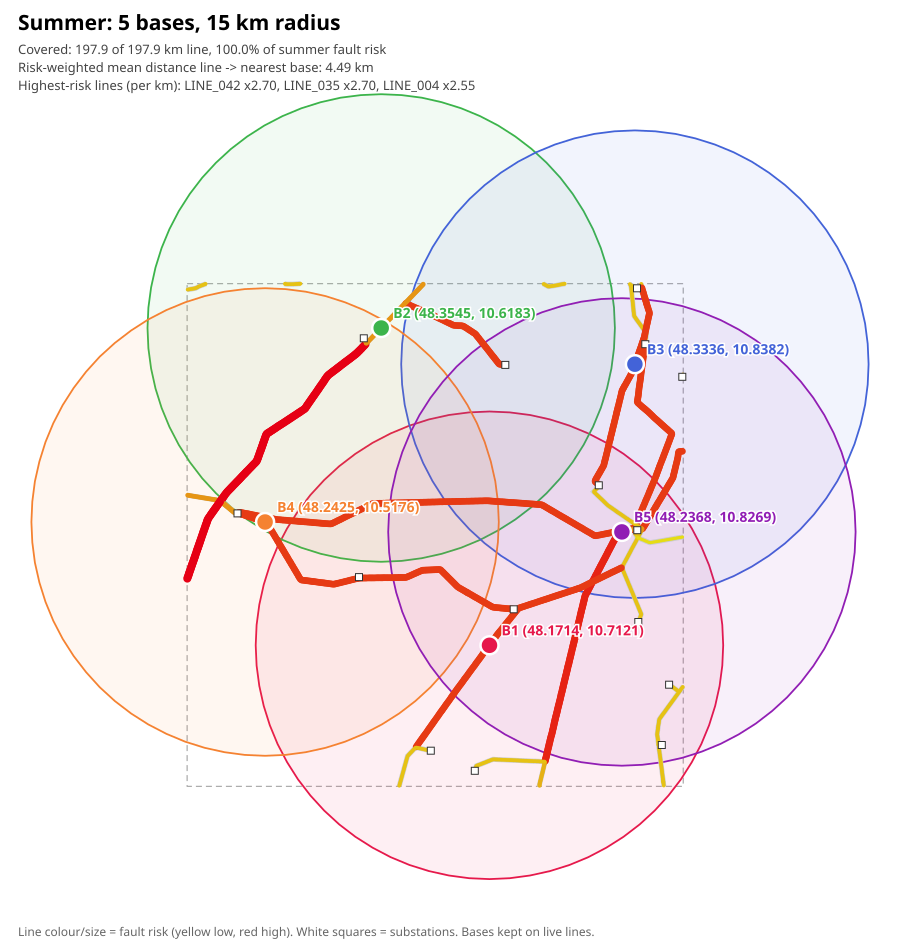
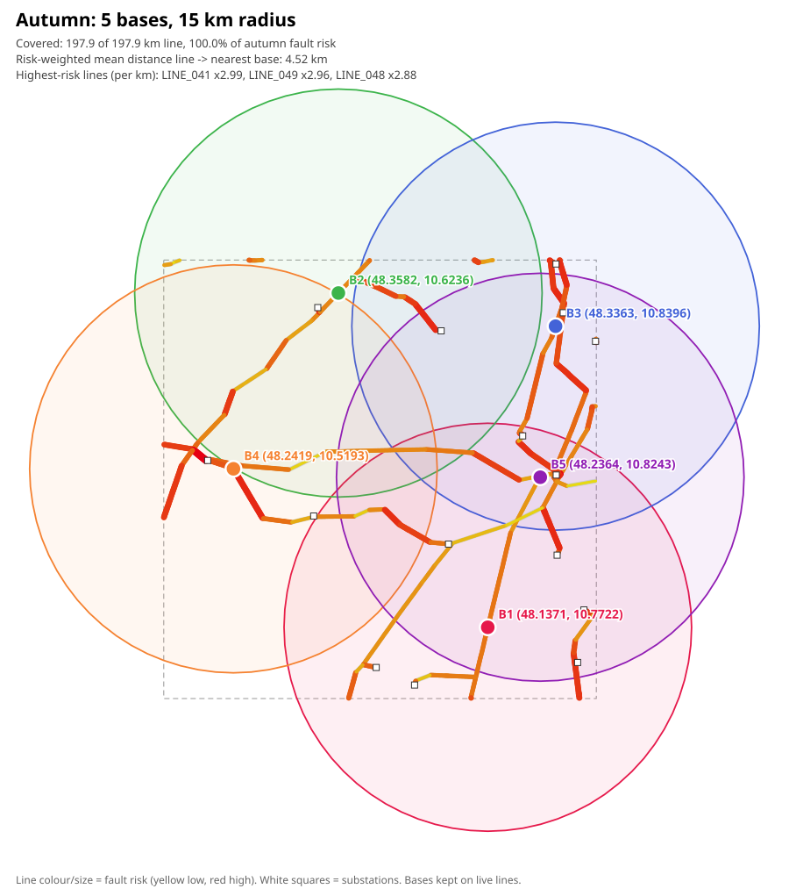

# Base placement: 5 bases, 15 km radius

Picks 5 base points so that their 15 km circles cover as much of the grid's lines as possible. Works on any LineString GeoJSON.

- `place_bases.py`: coverage of line length (maximal covering location problem), greedy search plus 1-swap improvement. Once everything is covered, a second stage moves the bases closer to the lines (p-median), which leaves more of each 8 km sortie for inspection. `--on-line` keeps bases on a line (a sensor recharges on a live line), and `--prob-field` weights each line by its fault probability (Bayesian search).
- `seasonal_bases.py` + `seasonal_config.json`: fault risk per season (crosswind, ice, vegetation, lightning, heat sag). Draws one plan per season plus a fixed all-year plan (expected risk, multi-start search). The multipliers are **assumptions**: the package has no seasonal fault data. Dead lines (`LINE_024`) cannot host a base.
- `maps/`: the resulting SVG maps; `maps/index.html` shows all five side by side.

```sh
python3 -I placement/place_bases.py data/grid_segments.geojson -k 5 -r 15 --on-line --step-km 0.1 --grid-km 0.2
python3 -I placement/seasonal_bases.py --segments data/grid_segments.geojson --nodes data/grid_nodes.geojson --out-dir placement/maps
```

Result: 197.9 of 197.9 km covered in every season. The seasonal plans differ from the all-year plan by no more than ~2 km, so one fixed set of bases is enough; the seasonal risk only sets the order in which lines are inspected.

## Maps

Coverage, 5 bases (no seasonal weights):



All-year plan (fixed bases, expected seasonal risk):


| Winter | Spring |
|---|---|
|  |  |
| **Summer** | **Autumn** |
|  |  |
